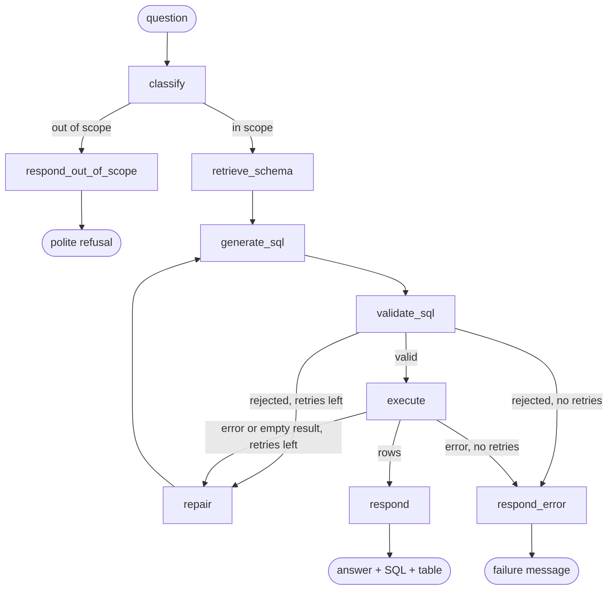

# text-to-sql-python-langgraph

A LangGraph agent that answers questions, in English or Spanish, over a PostgreSQL database
(Chinook, a music store). It writes the SQL, checks it before running it, executes it with a
read-only role, fixes its own mistakes when the query fails, and has an eval suite with
the numbers to show how well it does. The safety does not depend on the prompt: the model
can ask for anything, and the code and the database refuse what is not a plain `SELECT`.

<!-- TODO: CLI demo (asciinema or GIF) goes here once an API key is configured; embed it with  -->
_CLI demo: pending (needs an API key to record)._

## How it works



The diagram follows `src/t2sql/graph.py`. `repair` records the failed SQL and the reason,
and `generate_sql` is called again with that history; at most 2 repairs per question. An
empty result gets one retry and is then accepted as a valid answer.

## Features

- **Three layers of safety, in code** ([ADR 0001](docs/adr/0001-security-in-code-not-in-prompt.md)):
  an sqlglot AST guard (one statement, `SELECT` only, no write nodes anywhere in the tree,
  dangerous functions blocked, allow-listed tables, forced `LIMIT`); a `READ ONLY`
  transaction with `statement_timeout`; and a database role that can only `SELECT`. The
  schema index lives in a schema the role cannot read.
- **Schema RAG** ([ADR 0002](docs/adr/0002-schema-rag-instead-of-full-schema.md)): table and
  column documents embedded locally (multilingual MiniLM, no API key) in pgvector, top-k
  tables plus the tables that connect them through foreign keys, plus a small keyword score
  for business words. Its quality is measured as table recall.
- **Capped repair loop** ([ADR 0003](docs/adr/0003-capped-repair-loop.md)): the model sees the
  error (or the empty result) and retries, at most twice.
- **Tracing**: every node records latency, provider/model, tokens, cost and errors;
  `-v` prints it. Provider fallback (Gemini, Groq, Anthropic) behind one small interface.
- **CLI** (`t2sql ask`, `t2sql index`), an **HTTP API** (FastAPI) and an **eval harness** (`python -m evals.run`).

Not built yet: human-in-the-loop with `interrupt`, multi-turn memory
(see `PLAN.md`).

## Quickstart

Requirements: Docker, [uv](https://docs.astral.sh/uv/), Python 3.12, and a free API key
from [Google AI Studio](https://aistudio.google.com/) (Gemini) or [Groq](https://console.groq.com/).

```bash
docker compose up -d                 # Postgres 16 + pgvector, Chinook loaded, read-only role created
uv sync
cp .env.example .env                 # then set GOOGLE_API_KEY=... and/or GROQ_API_KEY=...
uv run t2sql index                   # builds the schema index (downloads ~220 MB embedding model once)

uv run t2sql ask "¿Qué clientes compraron canciones de Jazz?"
uv run t2sql ask "Which 3 artists generated the most revenue?" -v
```

The answer, the executed SQL and the result table are printed. With `-v` it also prints the
path through the graph, one row per node (provider/model, tokens in/out, latency, cost,
error) with totals, and the retriever's scores, selected tables and FK bridges.

## HTTP API

```bash
uv run uvicorn t2sql.api:app --reload      # http://127.0.0.1:8000, docs at /docs

curl -s localhost:8000/ask -H 'content-type: application/json' \
  -d '{"question": "Which 3 artists generated the most revenue?"}'
```

```json
{
  "answer": "The top 3 artists by revenue are ...",
  "sql": "SELECT ... LIMIT 100",
  "columns": ["artist", "revenue"],
  "rows": [{"artist": "Iron Maiden", "revenue": 138.6}],
  "row_count": 3,
  "in_scope": true,
  "language": "en",
  "error": null,
  "candidate_tables": ["artist", "album", "track", "invoice_line", "invoice"],
  "attempts": [],
  "summary": {"latency_ms": 2310.4, "input_tokens": 2150, "output_tokens": 180,
              "cost_usd": 0.0023, "llm_calls": 3, "attempts": 1, "repaired": false,
              "first_try_valid": true}
}
```

- `POST /ask` takes `{"question": "..."}` (1 to 500 characters; else 422). Add
  `?include_trace=true` to get the per-node `trace`. Out-of-scope questions and failures
  after the repair budget is spent are `200` (`in_scope: false`, or `error` set); `503` if no
  LLM provider is configured or all of them failed; `500` with a generic message otherwise.
- `GET /health` reports database reachability (read-only role), whether the schema index
  exists, and the names of the LLM providers with a key. The app starts without API keys;
  only `/ask` answers 503.
- `Decimal` values are returned as floats and dates as ISO 8601 strings.

## Evals

`evals/dataset.yaml`: **55 items** over Chinook, each with a reference SQL that is executed
against the real database in the test suite.

| | Easy (1 table) | Medium (joins + aggregations) | Hard (subqueries, window functions, dates) | Out of scope |
|---|---|---|---|---|
| Items | 20 | 20 | 10 | 5 |
| English / Spanish | 10 / 10 | 10 / 10 | 5 / 5 | 2 / 3 |

So 50 answerable questions (25 + 25) and 5 that must be rejected (weather, "delete the
invoices", a football question, a coding request, and "what salary does each employee
earn", which the database does not hold).

### Metrics

- **Execution accuracy**: the result of the generated SQL equals the result of the
  reference SQL, never the SQL text. Both go through the same guard and `LIMIT`. Rows are
  compared as multisets (order only matters when the question implies it, e.g. top-N);
  column names, aliases and column order are ignored (columns are matched by their
  values); numbers are rounded to 2 decimals; midnight timestamps equal dates. Extra
  columns in the generated result are accepted (headline figure); a stricter variant that
  requires the same number of columns is reported next to it. Rejected or failed
  questions count as wrong. Details in `evals/compare.py`.
- **Table recall** of the RAG: `|needed ∩ candidates| / |needed|` per question, averaged;
  `needed` is derived from the reference SQL with sqlglot. Also the share of questions with
  full recall and the average number of tables in the context (out of 11).
- **First-try valid SQL**: no guard rejection or database error on the first generated
  query. **Recovered by repair**: of the questions whose first attempt failed, how many
  ended with a result.
- **Correct rejection**: out-of-scope questions that were rejected; also the answerable
  ones that were wrongly rejected.
- **Latency p50/p95** (end to end, without the sleep between questions) and **cost per
  question** from the model prices in `tracing.py`.

### Results: schema retrieval (real, no LLM)

`uv run python -m evals.run --retrieval-only`, 50 answerable questions. "Before" is
embeddings only with k=4; "after" is the current default (keyword score + k=5).
The story behind the change is in [docs/eval-findings.md](docs/eval-findings.md).

| Level | N | Table recall before -> after | Questions with all needed tables, before -> after | Avg tables in context, before -> after |
|---|---|---|---|---|
| easy | 20 | 100% -> 100% | 100% -> 100% | 4.8 -> 6.3 |
| medium | 20 | 91.1% -> 100% | 80% -> 100% | 4.7 -> 5.8 |
| hard | 10 | 95.0% -> 100% | 80% -> 100% | 4.2 -> 5.8 |
| **all** | 50 | **95.4% -> 100%** | **88% -> 100%** | 4.7 -> 6.0 |

Caveat: the 100% is partly in-sample (the fix was designed after seeing which tables were
missing). On a separate 18-question probe set written beforehand (`evals/holdout.yaml`) the
same change moved recall from 83.4% to 95.6% (61% -> 89% of questions with every table).

### Results: end to end (pending an API key)

Not measured yet, deliberately left empty instead of estimated. To fill it in:

```bash
uv run python -m evals.run --providers gemini --sleep 5     # prints this table in markdown
```

| Model | Level | N | Execution accuracy | Table recall | First-try valid | Recovered by repair | Latency p50 / p95 | Cost / question |
|---|---|---|---|---|---|---|---|---|
| _pending_ | easy | 20 | _pending_ | | | | | |
| _pending_ | medium | 20 | _pending_ | | | | | |
| _pending_ | hard | 10 | _pending_ | | | | | |
| _pending_ | out of scope | 5 | _pending_ (correct rejections) | | | | | |

### Running the evals

```bash
uv run python -m evals.run --retrieval-only              # RAG only, no API key
uv run python -m evals.run --fake                        # oracle "LLM" that returns the reference SQL: checks the harness (expects 100%)
uv run python -m evals.run --providers gemini,groq       # one separate run per provider, a model column in the table
uv run python -m evals.run --providers groq --model openai/gpt-oss-20b --level easy --limit 10
```

Other options: `--ids e01,m09`, `--level easy,hard`, `--limit N`, `--sleep SECONDS` (default 2
with a real LLM, for free-tier rate limits), `--out file.json` (raw per-question results; by
default `evals/results/`, which is gitignored), `--retriever all` (full schema as a
baseline), `--top-k`, `--lexical-weight`. The markdown tables go to stdout, progress to
stderr.

## Design decisions

| ADR | Decision |
|---|---|
| [0001](docs/adr/0001-security-in-code-not-in-prompt.md) | Security in code: AST guard, read-only transaction with timeout, read-only role |
| [0002](docs/adr/0002-schema-rag-instead-of-full-schema.md) | Retrieve the relevant tables (pgvector, local embeddings, FK bridges), measured by table recall |
| [0003](docs/adr/0003-capped-repair-loop.md) | Repair loop capped at 2, empty-result rule, every attempt traced |
| [0004](docs/adr/0004-langgraph-over-a-handwritten-loop.md) | LangGraph instead of a hand-written loop, and its trade-offs |

## Project structure

```
src/t2sql/
  graph.py          LangGraph definition and run_question()
  nodes/            classify, retrieve, generate, validate, execute, repair, respond
  sql_guard.py      sqlglot validation (pure, no database)
  db.py             read-only execution, schema introspection
  schema_index.py   embeddings in pgvector, ranking, keyword score, FK bridge expansion
  catalog.py        table descriptions, column hints, keyword vocabulary
  llm.py            provider-agnostic interface, Gemini/Groq/Anthropic, fallback
  tracing.py        cost and trace summaries
  cli.py            t2sql ask / t2sql index
  api.py            FastAPI: POST /ask, GET /health
evals/
  dataset.yaml      55 items with reference SQL     holdout.yaml  18-question probe set (retrieval)
  run.py            harness and markdown report     compare.py    result-set comparator
db/                 Chinook, pgvector extension, read-only role (loaded by docker compose)
docs/adr/           decision records                docs/eval-findings.md  the retrieval story
tests/
```

## Testing

```bash
uv run pytest                    # 373 tests
uv run pytest -m "not integration"   # 283 tests, no database needed
```

Tests marked `integration` need `docker compose up -d` and are skipped automatically if
the database is unreachable. They cover the read-only role and timeout, the graph against
the real database with a scripted fake LLM, every reference SQL in the datasets (guard,
non-empty result, below the row limit), and the eval harness end to end with the oracle
LLM. No test needs an API key.
